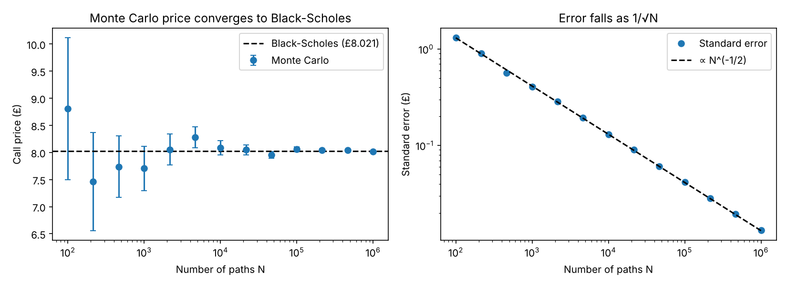

# Monte Carlo Option Pricing

Pricing a European call option by Monte Carlo simulation and validating the result against the Black–Scholes closed-form solution.

## Method

Under the risk-neutral measure the stock follows geometric Brownian motion,

    dS = r S dt + σ S dW,

with exact solution S_T = S_0 exp[(r − σ²/2)T + σ√T Z], Z ~ N(0,1).

The option price is the discounted expected payoff, C = e^(−rT) E[max(S_T − K, 0)], estimated by averaging over N simulated paths, with standard error σ_payoff / √N.

## Results

Parameters: S₀ = £100, K = £105, r = 5%, σ = 20%, T = 1 year.

| Method | Call price |
|---|---|
| Black–Scholes (exact) | £8.021 |
| Monte Carlo, N = 10⁶ | £8.015 ± 0.013 |

The Monte Carlo estimate agrees with Black–Scholes within one standard error. The standard error falls as N^(−1/2) (fitted slope −0.497), as expected from the central limit theorem.

## Run it

    pip install numpy scipy matplotlib
    python option_pricing.py

## Possible extensions

- Greeks (delta, vega) by finite differences vs analytic values
- Variance reduction (antithetic variates, control variates)
- Path-dependent options (Asian, barrier) with no closed-form solution
